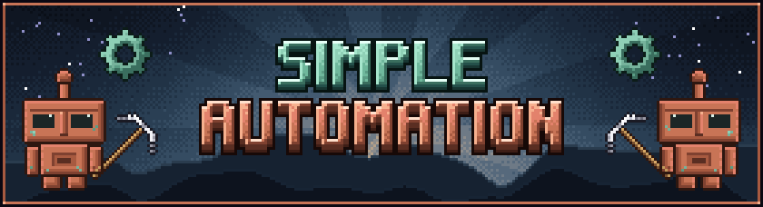
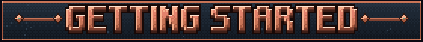
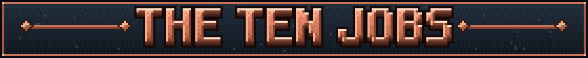
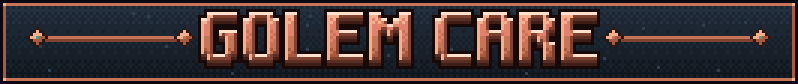
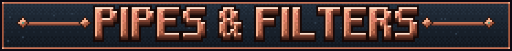
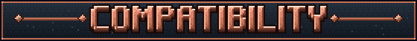

**Put your copper golems to work.** Mark out a zone, place a job controller, and the copper golems inside mine, farm, fish, fight, enchant and craft for you. No power, no upgrades: the tool you give a golem decides how well it works.

NeoForge 1.21.11.

---

1. Place **two Border Markers** at opposite corners of the area.
2. Place a **job controller** inside, with a **chest** next to it.
3. Build copper golems in the zone (or bring one on a lead).
4. Right-click each golem with the right **tool**. Done: they work and fill the chest.

Right-click the controller to see what is missing.

---

| Job | What it does |
|---|---|
| **Quarry** | Digs the whole zone down to bedrock. |
| **Lumber Yard** | Fells trees and replants them. |
| **Forge** | Fills and empties every furnace in the zone. |
| **Crusher** | Breaks ores and gives extra loot. |
| **Farm** | Harvests and replants crops, collects honey. |
| **Barn** | Breeds, shears, milks and culls animals. |
| **Fishery** | Fishes in the zone's water. |
| **Guard Post** | Kills the hostile mobs in the zone. |
| **Enchanter** | Enchants the items in the chest at an enchanting table. |
| **Workshop** | Crafts, smiths, cuts stone and brews from Recipe Cards. |

Experience goes into **Experience Crystals** in the chest.

---

Golems oxidize and slow down over time. Wax them with honeycomb, scrape them with an axe, or let lightning clean them. Sneak and right-click a golem with an empty hand to free it.

---

**Copper Pipes** move items instantly between chests. Use the **Wrench** to set each side to insert or extract, and a **Pipe Filter** to choose which items pass.

---

- **Jade** and **JEI** support.
- Modded tools, storage, ores, crops and animals work.
- Respects claim mods (FTB Chunks, Open Parties and Claims...).
- Server friendly: golems in a zone are not entities, and everything is configurable.
